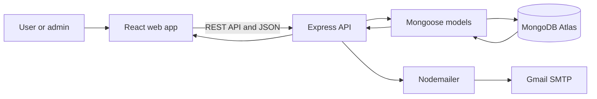

# Gatherly

### Discover events. Book your next experience.

Gatherly is a full-stack MERN event discovery and booking platform. Users can explore events, request bookings with email OTP verification, and track their bookings. Event organizers can manage events and review booking requests from an admin dashboard.

## Features

- **Account security:** Register and sign in with hashed passwords, JWT authentication, and email OTP verification.
- **Event discovery:** Browse and search upcoming events with dates, locations, categories, ticket prices, and available seats.
- **OTP-protected booking:** Verify a booking request by email before it is submitted.
- **Booking dashboard:** View and cancel your own booking requests.
- **Admin dashboard:** Create and remove events, review booking requests, and approve or reject bookings.
- **Payment tracking:** Admins can mark bookings as paid or unpaid. Gatherly tracks payment status; it does not process card payments.
- **Email updates:** Send account verification, password reset, booking verification, and booking confirmation emails.

## Tech stack

| Area | Technologies |
| --- | --- |
| Frontend | React, Vite, React Router, Axios, Tailwind CSS |
| Backend | Node.js, Express |
| Database | MongoDB Atlas, Mongoose |
| Authentication | JWT, bcryptjs |
| Email | Nodemailer, Gmail SMTP/App Password |

## How it works



### Booking flow

1. A user chooses an event and requests a booking OTP.
2. Gatherly emails the OTP to the account email.
3. The user submits the OTP and booking request.
4. The booking is saved as pending for admin review.
5. An admin approves or rejects it; approval updates the event's available seats and sends a confirmation email.

## Run locally

### Prerequisites

- Node.js and npm
- A MongoDB Atlas cluster and database user
- A Gmail account with 2-Step Verification and an App Password, if you want email OTPs

### 1. Clone and install

```bash
git clone https://github.com/Dilshad814/Gatherly-event-booking.git
cd Gatherly-event-booking
npm install
npm run install:all
```

### 2. Configure environment variables

Copy the example file:

```powershell
# Windows PowerShell
Copy-Item server/.env.example server/.env
```

```bash
# macOS/Linux
cp server/.env.example server/.env
```

Edit `server/.env` and set your own values:

```env
MONGO_URI=mongodb+srv://<database-user>:<password>@<cluster-host>/eventora
JWT_SECRET=<a-long-random-secret>
EMAIL_USER=<your-sender-gmail>
EMAIL_PASS=<your-google-app-password>
PORT=5000
NODE_ENV=development
```

In MongoDB Atlas, add your current public IP under **Security → Network Access**. For Gmail, use an App Password instead of your regular Gmail password. Never commit `server/.env`; it contains private credentials.

### 3. Start the app

From the project root, run:

```bash
npm run dev
```

By default, the web app is at `http://localhost:5173` and the API is at `http://localhost:5000/api`.

## API overview

All routes are prefixed with `/api`.

| Area | Endpoints | Access |
| --- | --- | --- |
| Authentication | `POST /auth/register`, `/auth/login`, `/auth/verify-otp`, `/auth/forgot-password`, `/auth/reset-password` | Public |
| Events | `GET /events`, `GET /events/:id` | Public |
| Event management | `POST /events`, `PUT /events/:id`, `DELETE /events/:id` | Admin |
| Bookings | `POST /bookings/send-otp`, `POST /bookings`, `GET /bookings/my`, `DELETE /bookings/:id` | Signed-in user |
| Booking review | `PUT /bookings/:id/confirm` | Admin |

## Admin access

Create an account through the app, then assign that account the `admin` role in the database. Keep admin credentials private; this repository does not include a default admin password.

## Project structure

```text
client/   React frontend
server/   Express API, MongoDB models, email service, and safe event seeder
```

## Security notes

- Keep real database, JWT, and email credentials in `server/.env` only.
- `server/.env.example` contains placeholders for setup and is safe to commit.
- The seed script only inserts missing sample events; it does not delete users, events, or bookings.
